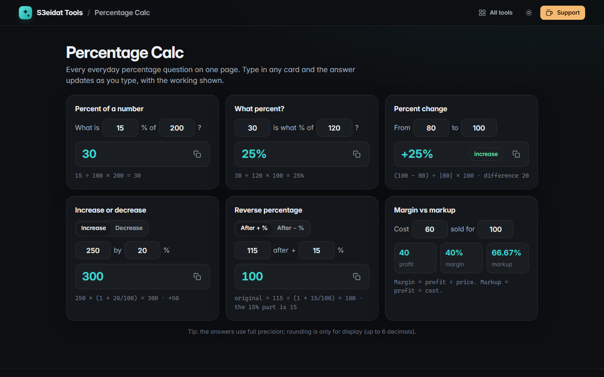

# Percentage Calc

> Every everyday percentage question on one page, answered live. Free, private, and it runs entirely in your browser.

### ▶ [Open Percentage Calc](https://s3eidat.github.io/percentage-calc/)



## Features

- **X% of Y**: what is 15% of 200?
- **What percent**: 30 is what % of 120?
- **Percent change** from an old to a new value, marked as increase or decrease (works with negative starting values)
- **Increase or decrease** a number by a percent, with the difference
- **Reverse percentage**: find the original before a +X% (e.g. remove 15% VAT) or −X% change
- **Margin vs markup** from cost and selling price, with profit
- The working is shown under every answer; one-click copy
- Float noise hidden (0.1 + 0.2 shows 0.3), accepts 1,000 and Arabic-Indic digits, remembers your inputs

## Privacy

Your numbers never leave your device. There is no server, no account, no analytics.
The page ships with a strict Content-Security-Policy (`connect-src 'self'`), so the browser
itself blocks any attempt to send data anywhere.

## Run it yourself

It's plain HTML, CSS and JavaScript with no build step:

```bash
git clone https://github.com/s3eidat/percentage-calc
cd percentage-calc
python -m http.server 8000
```

Then open http://localhost:8000.

## Support

If this saved you time, **[buy me a coffee ☕](https://s3eidat.github.io/coffee/)**. It keeps every tool free.

---

Part of **[S3eidat Tools](https://s3eidat.github.io/)**: 100+ free, private tools that run in your browser. MIT licensed.
